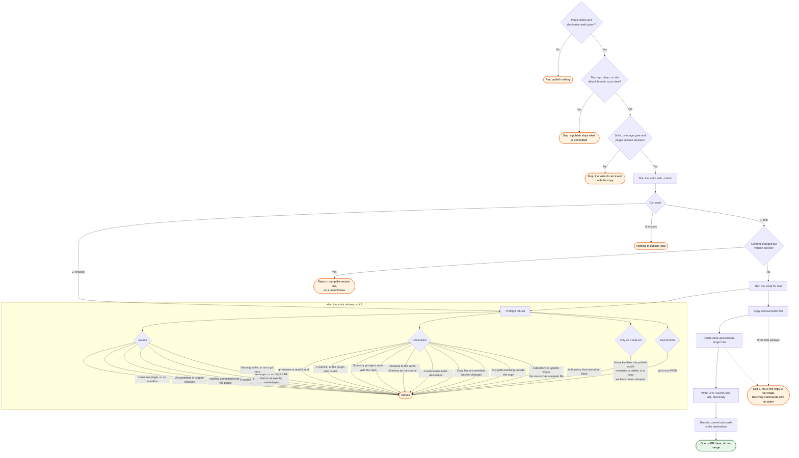

# publish — flow

What `/publish` does, and every way it or the script it runs can decline to act.

The two exit codes that are easy to conflate are `1` and `2`. `1` is "the copy is behind", which
is normal and is the reason to carry on. `2` is "a precondition does not hold **and nothing was
written**", which is a reason to stop and fix something. `3` covers both an unexpected exception
and a write that died partway: deliberately not `1`, so a crash can never be read as ordinary
drift, and deliberately not `2`, because by then the destination is no longer as you left it.

Most refusals happen under `--check` as well as under a real run, which is why the preflight box
hangs off both. The one exception is the untracked-file refusal: `--check` writes nothing, so
nothing is at risk, and a stray file is more useful reported as drift than turned into a refusal
to look.

The untracked-file refusal turns on whether the copy carries this tool's own `UPSTREAM.json`
naming this plugin and this source. With that stamp the directory is a mirror we manage, so an
untracked file in it is output from an earlier run and is swept; without it the directory belongs
to whoever made it, and the sweep would destroy work git cannot restore.
