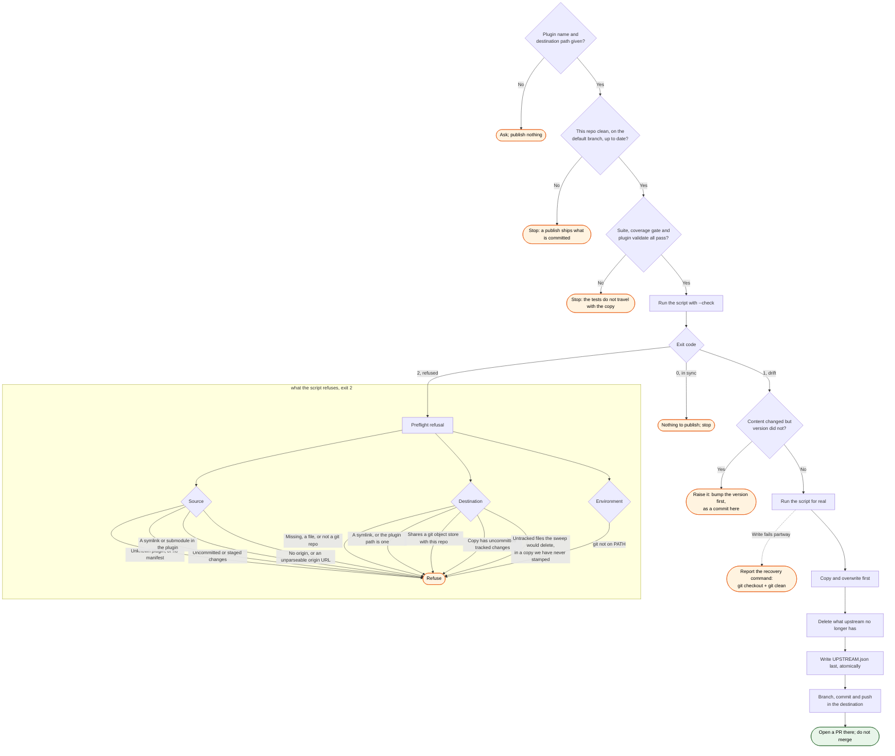

# publish — flow

What `/publish` does, and every way it or the script it runs can decline to act.

The two exit codes that are easy to conflate are `1` and `2`. `1` is "the copy is behind", which
is normal and is the reason to carry on. `2` is "a precondition does not hold", which is a reason
to stop and fix something. An unexpected exception is `3`, deliberately not `1`, so a crash can
never be read as ordinary drift.

The untracked-file refusal turns on whether the copy carries this tool's own `UPSTREAM.json`
naming this plugin and this source. With that stamp the directory is a mirror we manage, so an
untracked file in it is output from an earlier run and is swept; without it the directory belongs
to whoever made it, and the sweep would destroy work git cannot restore.
