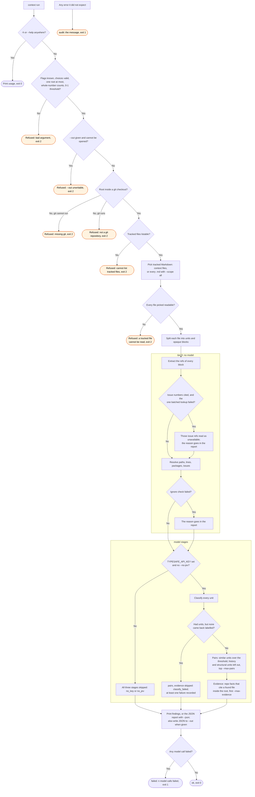

# context flow

`node scripts/audit.ts context` reports the references in a checkout's context files that no
longer resolve. The `/audit:context` skill runs it.

An issue lookup or ignore check that fails does not stop the run. The report states the reason,
and the exit status does not change. A `classify_failed` run always exits 1, because that
branch always records at least one failure.
