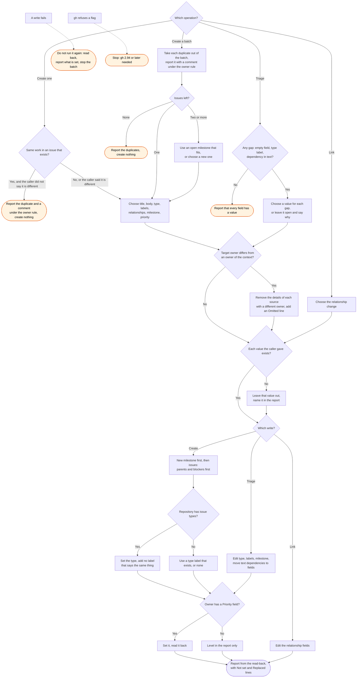

# gh:issues skill flow

What `gh:issues` does for each operation, and every way it can decline to act. Claude starts
the skill. It has no slash command. It never asks for confirmation, in the main session or in a
subagent.

The owner rule applies to each issue and each comment for a duplicate that the skill reports.
The skill compares the owner of each source with the target owner, by name only. Text for a
different owner names none of the details of that source. The report gives the kinds of
detail that it removed.

The skill never creates a label. It prefers an issue type to a label with the same meaning.
An owner with no Priority field is a fact to report, and the skill does not work around it.
