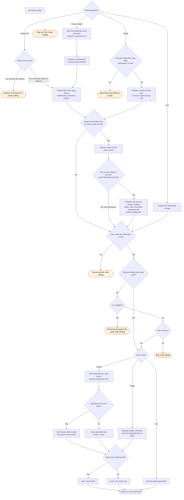

# gh:issues skill flow

What `gh:issues` does for each operation, and every way it can decline to act. Claude starts
the skill. It has no slash command.

Before it confirms a create, a batch or a triage, the skill checks each owner that gave the
issue context against the target owner. An issue in an owner outside the source's enterprise
names none of the source's details, and the proposal says which kinds it removed.

The skill never creates a label. It prefers an issue type to a label with the same meaning.
An owner with no Priority field is a fact to report, and the skill does not work around it.
