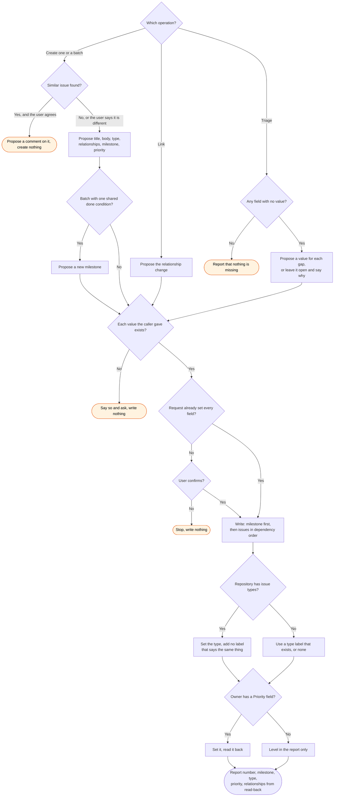

# gh:issues skill flow

What `gh:issues` does for each operation, and every way it can decline to act. Claude starts
the skill. It has no slash command.

The skill never creates a label, and prefers an issue type to a label with the same meaning. A repository with no issue types, or an owner with no
Priority field, is a fact to report. The skill does not work around it.
