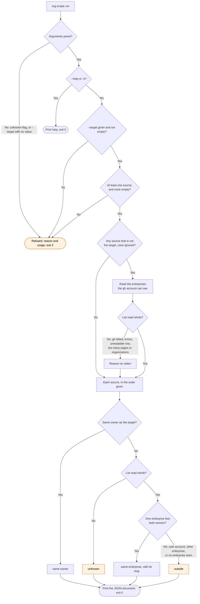

# org-scope flow

`node scripts/gh.ts org-scope --target <owner> <source-owner>...` prints one JSON document with
the scope of each source owner. The `gh:issues` skill runs it before it files an issue in the
repository of a different owner.

The command fails closed. A wrong `same-enterprise` puts private details in the edit history of
another owner's issue. A wrong `outside` only removes detail from the issue text. So the skill
reads `unknown` as `outside`. A source with the same owner as the target never needs `gh`.
