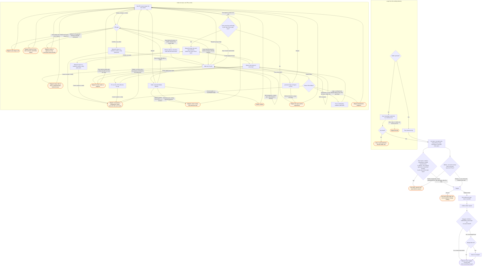

# /gh:shepherd skill flow

The `discover` subgraph is shared with `/gh:sync`, byte for byte. Both skills resolve their
scope by the same rule, `plugins/gh/src/discover.ts`. So the two diagrams must describe it
identically.
