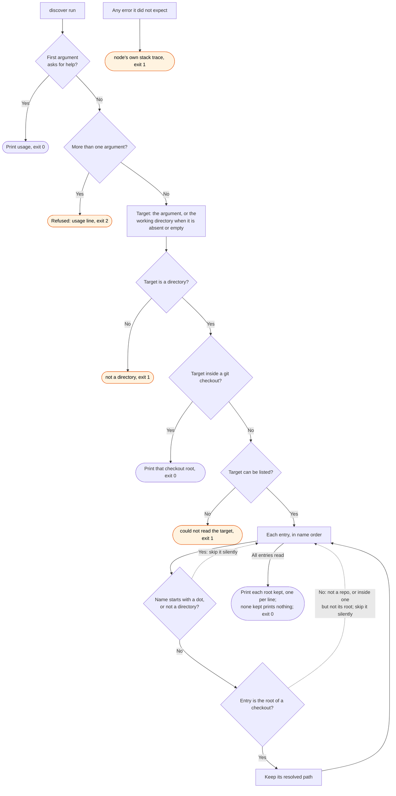

# discover flow

`node scripts/gh.ts discover` prints the checkout roots in scope for a directory, one per line.
The `/gh:shepherd` skill runs it to find its scope. `sync` uses the same rule in process.

A directory with no checkouts in it is an answer: empty stdout and exit 0. The two exit 1
outcomes are different facts, because the target itself could not be read. When git cannot run,
each checkout question answers no, so this command also prints nothing and exits 0. `gh.ts` has
no catch-all for this command, so an error it did not expect ends in node's own stack trace.
