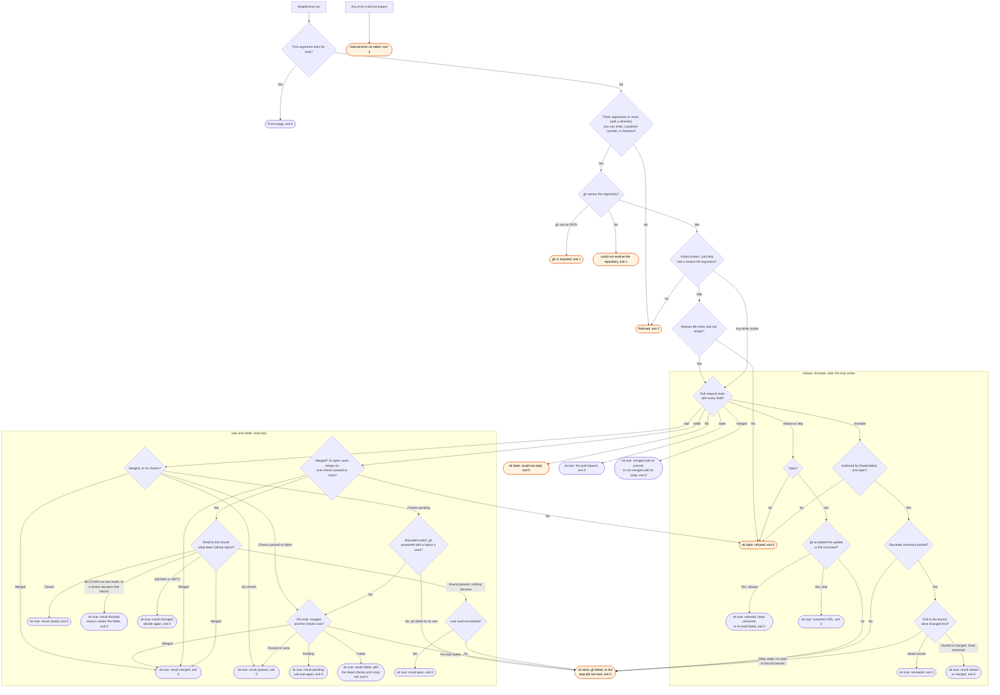

# shepherd-pr flow

`node scripts/gh.ts shepherd-pr` does one step on one pull request and prints one JSON object.
The `/gh:shepherd` skill and the `shepherd-repo` agent run it and decide the next step.

Once the arguments pass and gh names the repository, every step exits 0. Its JSON `ok` field
carries the result, and a refusal of a step is `ok: false`, not a status. `skip` checks its
reason file before it reads the pull request. The action name is checked only after gh answers,
so an unknown action with no gh is exit 1, not 2.
