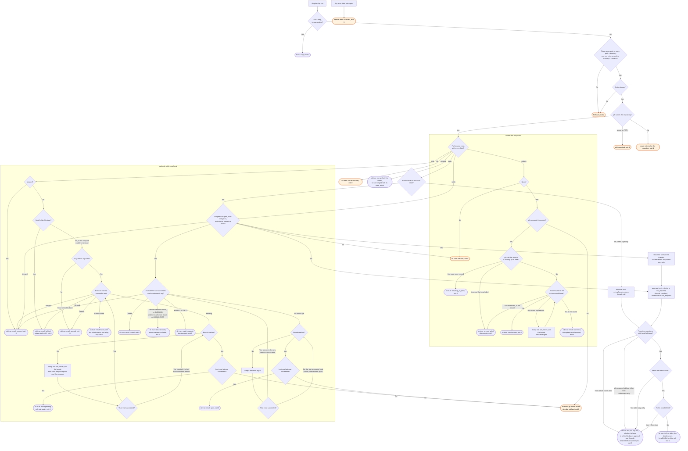

# shepherd-pr flow

`node scripts/gh.ts shepherd-pr` does one step on one pull request and prints one JSON object.
The `/gh:shepherd` skill and the `shepherd-prs` agent run it and decide the next step.

The action name is checked before any gh call, so an unknown action exits 2 with no gh call.
Once the arguments and the action pass, and gh names the repository, every step exits 0. Its
JSON `ok` field carries the result, and a refusal of a step is `ok: false`, not a status.
