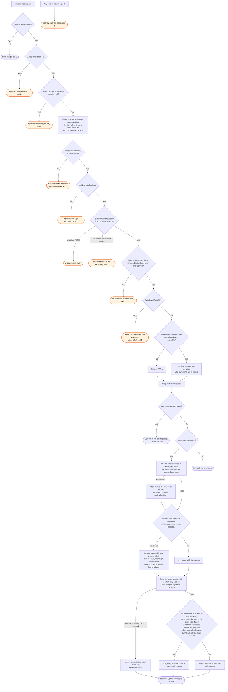

# shepherd-status flow

`node scripts/gh.ts shepherd-status` prints one JSON document about what `/gh:shepherd` would
work on in one repository, and changes nothing. The `/gh:shepherd` skill runs it, then dispatches
the `shepherd-prs` agent with the targets it names.

A run list that gh cannot read is not a failure: the wait bound falls back to 300 seconds. A
pull request list that gh cannot read is exit 1, because it says nothing about how many there
are. A window that fills the limit is a window, not an answer. This command refuses instead; it
does not report a truncated list. Exit 3 is outside the documented set, so a caller cannot read a
crash as an answer.

A stack is judged by the rules of its base, for every layer, as GitHub merges it (ruling 4 on
#469). A required check that is still pending, or has not reported, is no reason: the stack goes
to the loop, and `shepherd-stack wait` waits for it.
