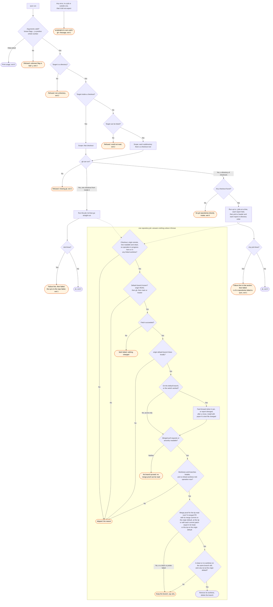

# sync flow

`node scripts/gh.ts sync` syncs the current checkout, or every checkout one level down. The
`/gh:sync` skill runs it. Each repository job is the `sync-repo` work, called in this process.

The merge proof uses the tip that the prune loop read, not the branch name (#248). The query
for merged pull requests has no base filter, so a stacked pull request is in it (#348). A row
proves a merge only when its merge commit is on the origin default. A row at another commit
proves the branch when `git cherry` finds each local commit in the head (#351, #450). The proof
fetches a merge commit or a head that is not local, one time. Two notes keep a branch on a git
failure: `could not fetch a merged PR's commits` and `git could not compare its commits`. Each
ends `unproven, not disproven`.

A skipped repository is a normal outcome. So is a kept branch. The job answers nothing either
way. Only a throw makes `sync` exit 1. The report is on stdout before the verdict.

The in-progress check on another worktree runs twice. It runs early, in the same preflight step
as the other checkout guards, before the fetch and the advance. It runs again, fresh, right
before the prune loop, because a worktree can switch branch in between. So a stopped rebase there
skips the whole repository on sight. Nothing is fetched, and no line names the default branch. A
worktree that switches branch afterward is checked again, right before its branch would be
removed.

With `--dry-run`, each change becomes a `would ...` line and nothing changes. `--no-install`
removes the install step. `scripts/gh.ts` catches an error it did not expect, in a job or outside
one. It reports that error as one stderr line, rather than node's own stack trace.
