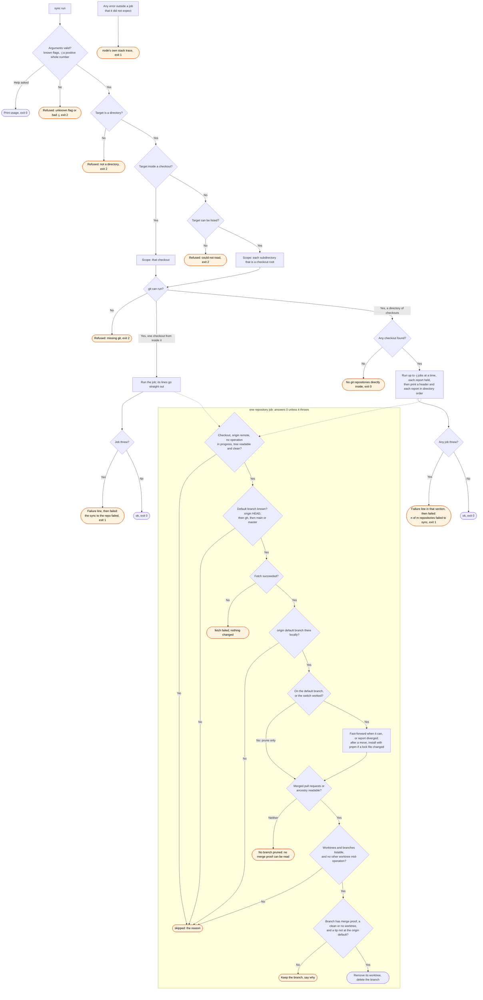

# sync flow

`node scripts/gh.ts sync` syncs the current checkout, or every checkout one level down. The
`/gh:sync` skill runs it. Each repository job is the `sync-repo` work, called in this process.

A skipped repository and a kept branch are normal outcomes, and the job still answers 0. Only a
job that throws makes `sync` exit 1, and the report is on stdout before the verdict. With
`--dry-run`, each change becomes a `would ...` line and nothing changes. `--no-install` removes
the install step. `gh.ts` has no catch-all, so an error outside a job ends in node's own stack
trace.
