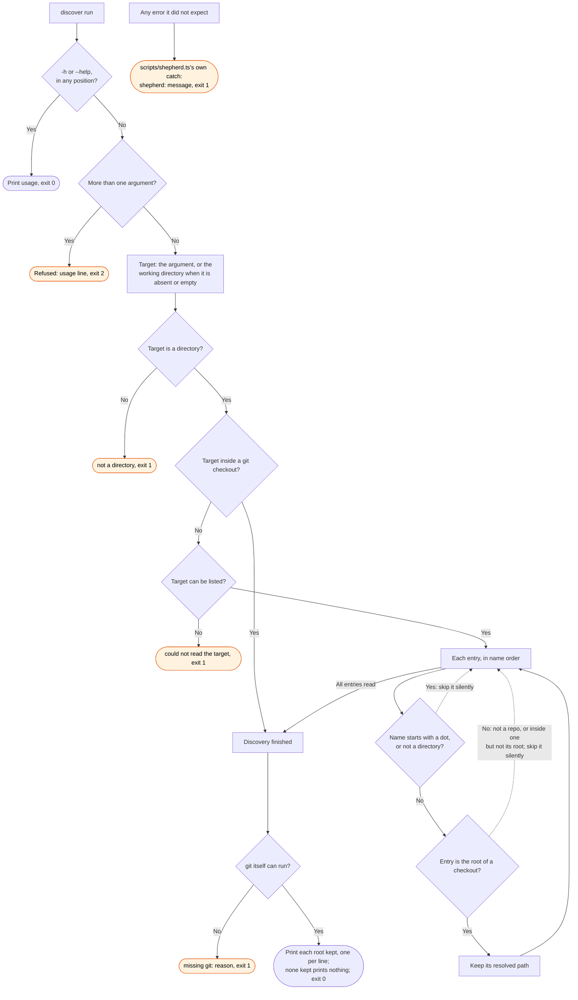

# discover flow

`node scripts/shepherd.ts discover` prints the checkout roots in scope for a directory, one per
line. The `/shepherd:merge` skill runs it to find its scope. The gh plugin's `sync` uses the same
rule in process.

A directory with no checkouts in it is an answer: empty stdout and exit 0. The two exit 1
outcomes at `not a directory` and `could not read the target` are different facts. Both mean the
target itself could not be read.

This command asks git whether it can run at all after discovery finishes and before it prints a
line. On a missing git, it says so and exits 1. It never treats "no checkouts found" as the
answer to a question discovery never asked. `scripts/shepherd.ts` catches an error this command did not
expect. It reports that error as one stderr line, rather than node's own stack trace.
