# shepherd-pr flow

`node scripts/shepherd.ts shepherd-pr` does one step on one pull request and prints one JSON
object. The `/shepherd:merge` skill and the `shepherd-prs` agent run it and decide the next step.

```mermaid
flowchart TD
    A[shepherd-pr run] --> B{-h or --help,<br/>in any position?}
    B -->|Yes| H([Print usage, exit 0])
    B -->|No| C{Three arguments or more, path a directory<br/>you can enter, a positive number, a checkout?}
    C -->|No| Z1([Refused, exit 2]):::stop
    C -->|Yes| I{Action known?}
    I -->|No| Z1
    I -->|Yes| IA{The fourth argument: a full sha for enqueue,<br/>a time or nothing for queue and queue-wait?}
    IA -->|No| Z1
    IA -->|Yes| G{gh names the repository?}
    G -->|gh not on PATH| Z2([gh is required, exit 1]):::stop
    G -->|No| Z3([could not resolve the repository, exit 1]):::stop
    G -->|Yes| R{Pull request read,<br/>with every field?}
    R -->|No| RU([ok false: could not read, exit 0]):::stop
    R -->|state| SR{Review rules of the base read?}
    SR -->|No: stderr says why| SN[approval from reviewDecision alone;<br/>threads null]
    SR -->|Yes| SRT{Rules ask for resolved threads?}
    SRT -->|Yes| STR[Read the unresolved threads;<br/>a failed read is null, stderr says why]
    SRT -->|No| SV
    STR --> SV[approval: met, missing or not_required;<br/>threads: resolved, unresolved or not_required]
    SN --> SY
    SV --> SY{From this repository,<br/>with headRefName?}
    SY -->|From a fork: no ref read| S
    SY -->|gh answered without isCrossRepository<br/>or headRefName: stderr says why| S
    SY -->|Yes| SY2{Ref of the branch read?}
    SY2 -->|No: stderr says why| S
    SY2 -->|Yes| SY3{Ref is headRefOid?}
    SY3 -->|Yes: inSync true| S
    SY3 -->|No| SO([ok true: inSync false, the detail names<br/>headRefOid and the ref, exit 0])
    S([ok true: the pull request, whether its head<br/>is behind its base, approval and threads,<br/>branchRefOid and inSync, exit 0])
    R -->|merged| M([ok true: merged with its commit,<br/>or not merged with its state, exit 0])

    subgraph writes [rebase: the branch update]
        R -->|rebase| RB{Open?}
        RB -->|No| RF([ok false: refused, exit 0]):::stop
        RB -->|Yes| RB2{gh accepted the update?}
        RB2 -->|Yes| RB4{gh said the branch<br/>is already up to date?}
        RB4 -->|Yes: read once, no poll| RB5([ok true: result up_to_date, exit 0])
        RB4 -->|Yes, and that read failed| RB3
        RB4 -->|No| RB6{Head moved on the<br/>last successful read?}
        RB6 -->|Yes| RB7([ok true: result moved, exit 0])
        RB6 -->|No, bound not reached| RB8[Sleep one poll, never past the bound,<br/>then read again] --> RB6
        RB6 -->|No, at the bound| RB9([ok true: result unmoved,<br/>the update is still queued, exit 0])
        RB6 -->|Last read failed, at the bound| RB3([ok true: re-read failed,<br/>after empty, exit 0])
    end
    RB2 -->|No| OF([ok false: gh failed, or the<br/>step did not land, exit 0]):::stop

    subgraph enqueue [enqueue: the queue write]
        R -->|enqueue| EQ{The base has a merge queue?}
        EQ -->|No| EN([ok false: no_queue, no write, exit 0]):::stop
        EQ -->|Could not be read| EU([ok false: unread, no write, exit 0]):::stop
        EQ -->|Yes| EO{Open?}
        EO -->|No| EF([ok false: not_open, no write, exit 0]):::stop
        EO -->|Yes| ES{A layer of an open stack?}
        ES -->|Yes| EST([ok false: stacked; a stack goes in<br/>only with gh stack merge, exit 0]):::stop
        ES -->|Not found, and the stacks read short| EU
        ES -->|No| EH{The head is the head the caller read?}
        EH -->|No| EM([ok false: head_moved, no write, exit 0]):::stop
        EH -->|Yes| EE{Already in the queue?}
        EE -->|Could not be read| EU
        EE -->|Yes| EQD([ok true: queued, no write, exit 0])
        EE -->|No| EW[enqueuePullRequest with expectedHeadOid;<br/>never jump]
        EW -->|An entry| EOK([ok true: enqueued, exit 0])
        EW -->|GitHub's errors, no entry| ER([ok false: refused, GitHub's words, exit 0]):::stop
        EW -->|No node id, nothing sent| EU
        EW -->|A timeout, or a reply that says nothing| EA{Read the entry once more}
        EA -->|An entry| EAQ([ok true: queued, after the write, exit 0])
        EA -->|None, or could not be read| EAU([ok false: unconfirmed; the write<br/>can have landed, exit 0]):::stop
    end

    subgraph queue [queue and queue-wait: read only]
        R -->|queue or queue-wait| QR{The entry and the removals read?}
        QR -->|No| QU([ok false: could not read the queue, exit 0]):::stop
        QR -->|Yes| QV{What the read says}
        QV -->|Merged| QM([merged, with the time in the queue])
        QV -->|An entry| QQ[queued]
        QV -->|No entry, a removal at or after since| QD([removed: the drop class, merge_conflict,<br/>stack_invalidated, invalid_merge_commit or other,<br/>with the time in the queue])
        QV -->|No entry, open, auto-merge on| QW[waiting: GitHub adds it<br/>when the rules are met]
        QV -->|No entry, nothing will add it| QN([not_queued])
        QQ -->|queue| QQE([ok true: queued, exit 0])
        QW -->|queue| QWE([ok true: waiting, exit 0])
        QW -->|queue-wait, its checks failed| QF([ok true: failed; GitHub will not add it])
        QQ -->|queue-wait| QB{Bound reached?}
        QW -->|queue-wait| QB
        QB -->|No| QS[Sleep one poll, then read again] --> QT{That read succeeded?}
        QT -->|Yes| QV
        QT -->|No: counted| QB
        QB -->|Yes, last read succeeded| QP([ok true: pending, with queue_state, exit 0])
        QB -->|Yes, last read failed| OF
    end

    subgraph reads [wait and settle: read only]
        R -->|wait| W{Merged?}
        W -->|Yes| MG([ok true: result merged, exit 0])
        W -->|No| WB{Head behind its base?}
        WB -->|Yes| WBH([ok true: result behind,<br/>rebase before CI, exit 0])
        WB -->|No, or the compare<br/>could not be read| WN{Any checks reported?}
        WN -->|No| WP([ok true: result passed, exit 0])
        WN -->|Yes| W3{Evaluate the last<br/>successful read}
        W3 -->|Merged| MG
        W3 -->|Head behind its base| WBH
        W3 -->|Passed| WP
        W3 -->|A check failed| WF([ok true: result failed, with<br/>the failed checks and a log tail, exit 0])
        W3 -->|Pending| WJ[Read every page of the jobs of each Actions run<br/>with a pending check, up to 20 pages]
        WJ --> WM{Was every jobs read complete?}
        WM -->|No: a page failed, past 20 pages,<br/>or a job that could not be read| WM2[The stall bound of this poll is doubled;<br/>stderr says why]
        WM -->|Yes| WK{Any stamp on a check, job or step?}
        WM2 --> WK
        WK -->|No| WD[The newer of the head commit date and updatedAt<br/>is the one stamp; neither: idle null, stderr says why]
        WK -->|Yes| WL
        WD --> WL{Idle for the stall bound?}
        WL -->|Yes| WS([ok true: result stalled,<br/>with the progress, exit 0])
        WL -->|No, or idle null| W9{Bound reached?}
        W9 -->|Yes| W7{Last read attempt succeeded?}
        W7 -->|Yes| WPE([ok true: result pending, with the progress,<br/>call wait again, exit 0])
        W9 -->|No| W10[Sleep one poll, never past the bound,<br/>then read the pull request and the compare]
        W10 --> W11{That read succeeded?}
        W11 -->|Yes| W3
        W11 -->|No: counted, the last<br/>successful read stands| W9
        R -->|settle| ST{Merged? Or open, auto-merge on,<br/>and checks passed or none?}
        ST -->|Merged| MG
        ST -->|Yes| ST3{Evaluate the last successful<br/>read: what does it say?}
        ST3 -->|Merged| MG
        ST3 -->|Closed| ST4([ok true: result closed, exit 0])
        ST3 -->|A review decision blocks, or BLOCKED<br/>and the read before it was ALSO BLOCKED| ST5([ok true: result blocked,<br/>reason names the fields, exit 0])
        ST3 -->|BEHIND or DIRTY| ST6([ok true: result changed,<br/>decide again, exit 0])
        ST3 -->|No verdict yet| ST9{Bound reached?}
        ST9 -->|Yes| ST7{Last read attempt succeeded?}
        ST7 -->|Yes| ST8([ok true: result open, exit 0])
        ST9 -->|No| ST10[Sleep, then read again]
        ST10 --> ST11{That read succeeded?}
        ST11 -->|Yes: becomes the new<br/>last successful read| ST3
        ST11 -->|No: the last successful read<br/>stands, unevaluated again| ST9
    end
    ST -->|No| RF
    W7 -->|No| OF
    ST7 -->|No| OF

    X[Any error it did not expect] --> Z6([internal error on stderr, exit 3]):::stop

    classDef stop fill:#fff3e0,stroke:#e65100,color:#000
```

The action name is checked before any gh call, so an unknown action exits 2 with no gh call.
Once the arguments and the action pass, and gh names the repository, every step exits 0. Its
JSON `ok` field carries the result, and a refusal of a step is `ok: false`, not a status.

`enqueue` reads the queue of the base before each other check, and every refusal comes before
the write (ruling 9 on #503). It never sets `jump`, and nothing here removes a pull request from
a queue. A removal before `since` is from an earlier pass through the queue, so `queue` does not
read it as this pass's drop.
