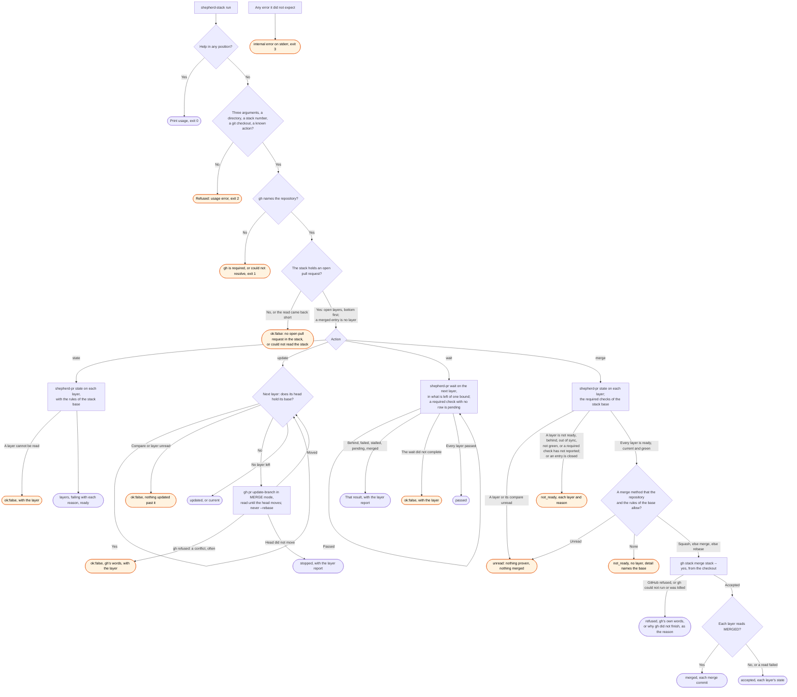

# shepherd-stack flow

`node scripts/shepherd.ts shepherd-stack <path> <stack> <action>` runs one step on one GitHub
stack.
The `shepherd-prs` agent runs it for a stack target that `shepherd-status` gave. Each layer is a
`shepherd-pr` step, judged by the rules of the stack base (ruling 4 on #469).

No step force pushes. `update` asks GitHub to merge the base into a layer, and GitHub then merges
such a stack (the probe of ruling 3 on #469). `gh stack merge` is all or nothing, and GitHub
applies the rules of the base to it. A read that failed never decides a verdict: it gives
`ok:false` or `unread`, and the agent reads again. Required checks that could not be read are the
one exception: the rollup alone decides, and GitHub still applies the rules.
