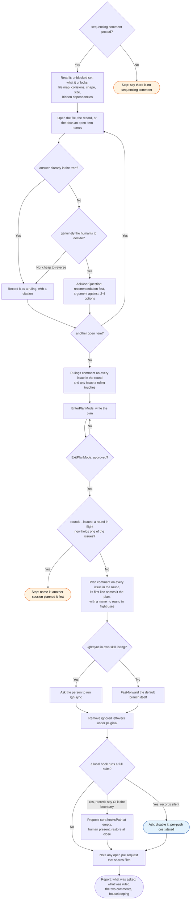

# /workstreams:question skill flow

What `/workstreams:question` does to one sweep report, and every way it declines to act.

The hook question is the one case in the whole skill where a cheap ruling is not taken,
when the records are silent. If you disable a push-time suite, you change what protects
the round. So this question is asked, not ruled, even though it is, in every other
sense, reversible.
