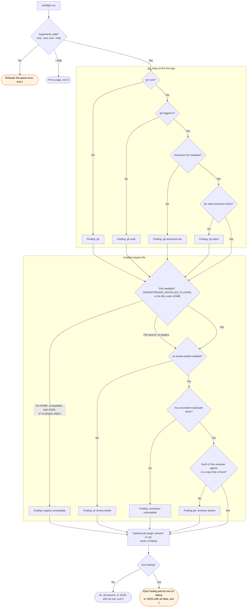

# preflight flow

`node scripts/workstreams.ts preflight` checks what the workstreams skills depend on. The
`/workstreams:sweep`, `/workstreams:question`, `/workstreams:review` and `/workstreams:stream`
skills run it first.

The gh checks stop at the first gap, so a run reports at most one gh finding. The plugin checks
always run, and their findings add to it. An absent plugin file reads as no plugins, not as an
unreadable file. The optional array never changes the exit status.
