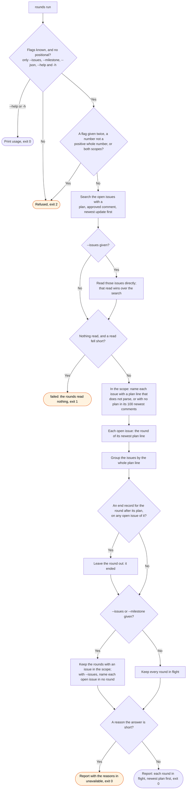

# rounds flow

`node scripts/workstreams.ts rounds` names the rounds in flight, each with its plan line and its
open issues. The `/workstreams:start` skill runs it to find the round it continues, and
`/workstreams:question` runs it once more before it posts a plan.

An issue is in one round only: the round of its newest plan comment. So a lookup by the issues of
one round never reaches another round. A round with no open issue is not in flight, so the rounds
that ended before #368 added the end record do not come back. The search can take a minute to see
a new comment. A direct read by issue number sees it at once.
