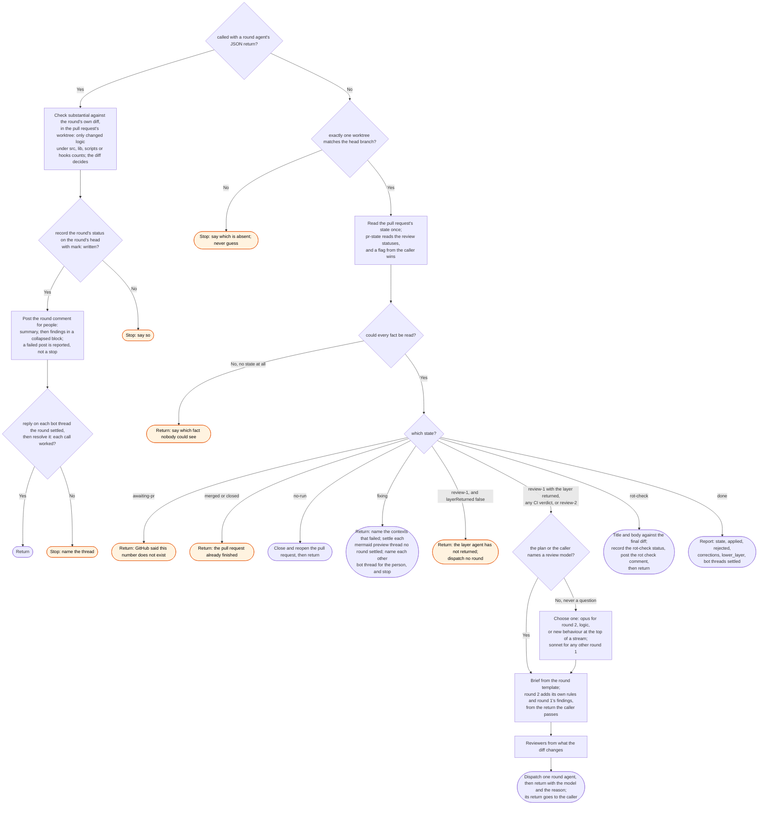

# /workstreams:review skill flow

What `/workstreams:review` does in one call on one pull request, and every way it declines to
act. Each call takes one step and returns. The caller waits between calls.

The round brief holds the rules inside the round agent. Reviewers are read-only, and finish
before any edit. The findings list comes before any edit, and goes in the return. Each
finding and each rejection is cited. A claim that something is tested is mutated first.
Round 2 checks round 1's commits before anything else. The round agent does not end its
turn, or return, while a reviewer it dispatched still runs. Then it reads CI and the unresolved
threads once, and fixes them with the findings in one pass. Each bot thread is a finding too. A
mermaid preview thread is rejected as informational. The return lists each bot thread in
`bot_threads`. It returns after the push and the run
check, and does not watch CI.
