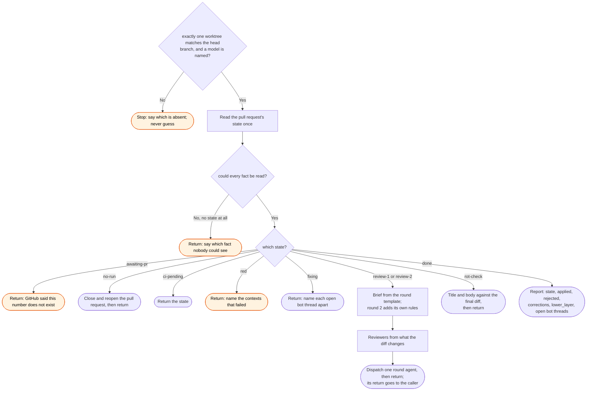

# /workstreams:review skill flow

What `/workstreams:review` does in one call on one pull request, and every way it declines to
act. Each call takes one step and returns. The caller waits between calls.

Inside the round agent, the rules of the round brief hold: reviewers are read-only and finish
first, the findings file comes before any edit, each finding and each rejection is cited, and a
claim that something is tested is mutated first. Round 2 checks round 1's commits before
anything else.
