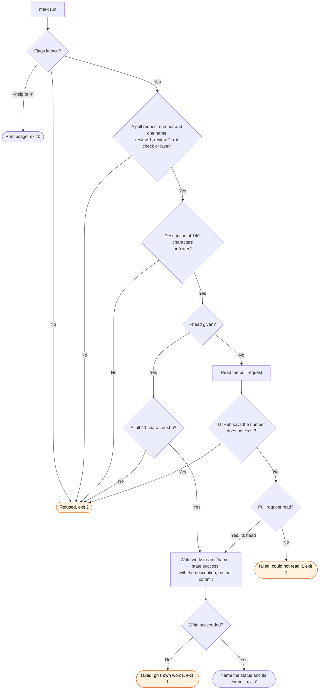

# mark flow

`node scripts/workstreams.ts mark` records one finished step of the review loop as a commit
status. `/workstreams:review` runs it after each round and after the rot check.
`/workstreams:start` runs it when the person asks to skip the review of a layer.

Every refusal comes before any read, except the pull request that does not exist. A list on the
pull request that ran past one page does not stop the write, because the head is still read.

A status cannot be deleted. A later push leaves it on an older commit of the pull request, where
`pr-state` still reads it. `pr-state` reads `review-1`, `review-2` and `rot-check`. Nothing
reads `layer` yet (#396).
