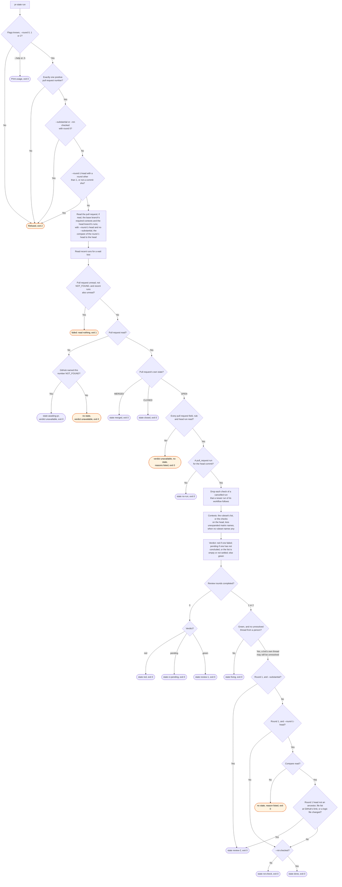

# pr-state flow

`node scripts/workstreams.ts pr-state` reports where the review loop is on one pull request. The
`/workstreams:review` and `/workstreams:start` skills run it.

SUCCESS, SKIPPED and NEUTRAL each satisfy a context, and any other conclusion fails it. A
contexts list from the head is settled only when every run for the head has completed. A failed
wait-hint read adds a reason to the list but does not change the verdict. An unresolved thread
from a person blocks `done`.

A check from a cancelled workflow run does not count when a newer run of the same workflow has a
check on the head (#364). After the newer run makes its first check, a name it has not reported
yet is pending, not failed. Before that check, the cancelled run's checks still count, because
the check list shows no newer run. A cancelled run that no newer run follows still counts. A
commit status has no run, so it always counts. The list from the head leaves out a name that
contains `${{`, a matrix job that did not expand.

A bot's own thread, a review bot such as Copilot included, is named apart. It does not block
`done`, and neither does a plain comment (#219). A review bot's own finding is named, but the
loop does not wait on it.

State `awaiting-pr` means GitHub itself named the number NOT_FOUND. Every other reason leaves no
state at all. A malformed reply is one such reason. A repository gh could not resolve is
another. A read gh refused outright is a third. A NOT_FOUND for a field nested under the pull
request, rather than the pull request itself, is a fourth: that field is gone, not the number.

`--round-1-head` is line 2 of the round 1 marker (#356). The compare compares commits, not
times, because a rebase moves commit dates. A round 1 head that is not an ancestor of the head
(`diverged` or `behind`) gives `review-2`. So does a file list at GitHub's limit of 300, which
can be short. A logic file is under `src/`, `lib/`, `scripts/` or `hooks/` at any depth. A test
file, a file under a test directory, and a Markdown file are not logic. `sinceRound1` gives the
reason.

A merged or closed pull request gives state `merged` or `closed`. This check runs right after
`awaiting-pr`, before every other rule. CI, threads and markers do not change it.
