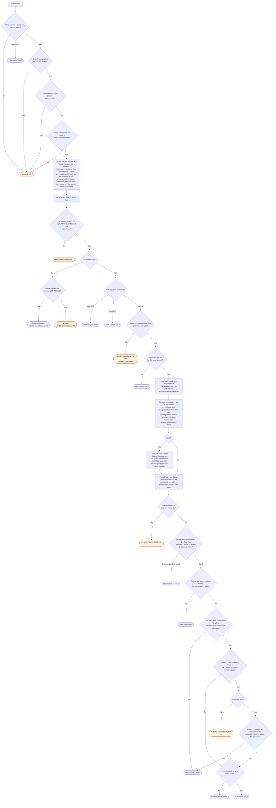

# pr-state flow

`node scripts/workstreams.ts pr-state` reports where the review loop is on one pull request. The
`/workstreams:review` and `/workstreams:start` skills run it.

At round 0 the verdict does not hold the first review (#384). Green, pending and red each give
`review-1`, so round 1 starts while CI runs. After a round, CI that is not green gives `fixing`,
and `done` needs green.

SUCCESS, SKIPPED and NEUTRAL each satisfy a context, and any other conclusion fails it. A
contexts list from the head is settled only when every run for the head has completed. A failed
wait-hint read adds a reason to the list but does not change the verdict. An unresolved thread
blocks `done`.

A check from a cancelled workflow run does not count when a newer run of the same workflow has a
check on the head (#364). `pr-state` also reads the runs for the head, so a newer run that has
made no check yet supersedes it too (#370). A name the newer run has not reported yet is pending,
not failed. A newer run that completed with no check does not supersede. A cancelled run that no newer run follows still counts. A commit status has no run, so
no newer run supersedes it. The list from the head leaves out a name that
contains `${{`, a matrix job that did not expand.

With no ruleset, the list from the head also leaves out a pending check with no workflow run
(#383): a commit status at `PENDING` or `EXPECTED`, or a check run that no workflow made, with no
conclusion. Nothing on the head waits for it. Once it concludes, it counts. A check with a run,
and each name a ruleset requires, still counts while it is pending. When a check with a run
reports the same name, that check answers for it. When only checks with no run report it, a newer
pending one still answers, such as a re-run of an app's check.

A workflow can skip a job on a draft (#365). GitHub skips a matrix job before the matrix expands,
so the check keeps the expression, such as `Analyze (${{ matrix.language }})`. On a draft, a
required context that no check on the head names is `draftSkipped` when a check on the head,
from a check suite that concluded `SKIPPED`, has a `${{ ... }}` name that matches it. Each
`${{ ... }}` matches one or more characters that are not `(` or `)`, and the rest matches
literally. The verdict leaves these contexts out, and the text says each one "runs after ready
for review". A context that a check names keeps its own verdict. This includes a check from a
superseded cancelled run. When the pull request is not a draft, `draftSkipped` is empty. No
workflow file is read. This is a heuristic: a skipped check with a broad name, such as
`${{ matrix.os }}`, matches each name with no parenthesis.

A bot's own thread, a review bot such as Copilot included, is named apart, under `botThreads`.
After a round, it gives `fixing`, as a person's thread does (#383, round 15 ruling 7). This
reverses part of #219. #219 still holds by its second option: the report names each bot thread.
The review skill replies on and resolves each one that a round settled, and each mermaid preview
thread. It names each other bot thread for the person. A plain comment never blocks `done`.

State `awaiting-pr` means GitHub itself named the number NOT_FOUND. Every other reason leaves no
state at all. A malformed reply is one such reason. A repository gh could not resolve is
another. A read gh refused outright is a third. A NOT_FOUND for a field nested under the pull
request, rather than the pull request itself, is a fourth: that field is gone, not the number.

The review facts come from the `workstreams/<name>` commit statuses that `workstreams.ts mark`
writes, on the first 100 commits of the pull request and on the head each of the first 100
force-pushes replaced (#377). A `review-2` status gives round 2, a `review-1` status round 1,
and none round 0. The FIRST `review-1` status, by its time, gives the round 1 head and whether
round 1 was substantial (#395). A second one, after a resumed round, does not move the head. A `rot-check` status gives
the rot check. Only a status with state `success` counts. Each flag that is given wins over its
status (mid-round ruling 14). A status read that fell short gives no state
unless `--round` is given, and then the flags alone are the facts. A force-push, as in a
restack, takes its commits out of the pull request. The read still reads the head it replaced,
but not a commit below that head.

`layerReturned` is `true` with a `success` `layer` status on any commit the read covers, a head
that a force-push replaced included (#396). Round 1 or more, from a status or from `--round`,
also gives `true`: a round reviews only a layer that returned. A restack can drop the `layer`
status with its commit, and a review status then keeps the fact. No state reads it. The skills
start no round 1 while it is `false`. A status read that fell short gives `false`, unless
`--round` is 1 or more. The state is then null, so no round starts.

A `workstreams/` status is never a context. It is not in the head list, and not in the verdict,
also when a ruleset names it.

The round 1 head is what round 1 reviewed (#356). The compare compares commits, not
times, because a rebase moves commit dates. A round 1 head that is not an ancestor of the head
(`diverged` or `behind`) gives `review-2`. So does a file list at GitHub's limit of 300, which
can be short. A logic file is under `src/`, `lib/`, `scripts/` or `hooks/` at any depth. A test
file, a file under a test directory, and a Markdown file are not logic. `sinceRound1` gives the
reason.

A merged or closed pull request gives state `merged` or `closed`. This check runs right after
`awaiting-pr`, before every other rule. CI, threads and review statuses do not change it.
