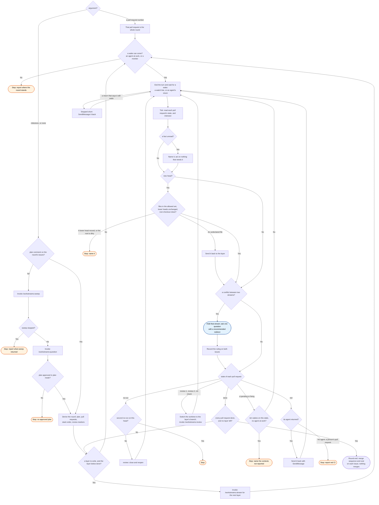

# /workstreams:start skill flow

What `/workstreams:start` does to a round or to one pull request, and every way it stops.

A layer's return goes to `/workstreams:stream` to read. A round agent's return goes to
`/workstreams:review`, which posts the round's marker. A `lower_layer` finding goes into its layer only in a gap. In a gap, no agent writes to that
layer or above it. Otherwise the finding waits for the round-end report.
