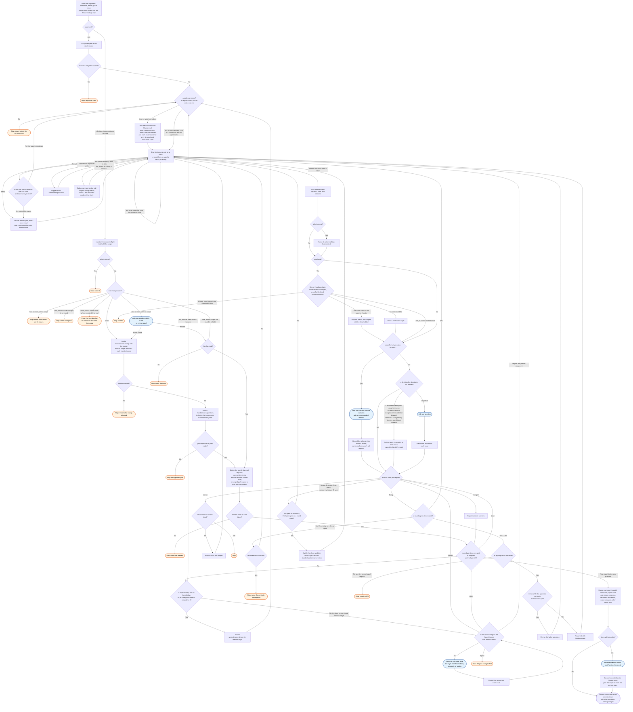

# /workstreams:start skill flow

What `/workstreams:start` does to a round or to one pull request, and every way it stops.

A layer's return goes to `/workstreams:stream` to read. A round agent's return goes to
`/workstreams:review`, which posts the round's marker. A `lower_layer` finding goes into its layer only in a gap. In a gap, no agent writes to that
layer or above it. Otherwise the finding waits for the round-end report.

A layer agent returns after its push and the run check, with CI still able to run. `pr-state`
gives `review-1` while CI runs, so the tick waits only for that agent's return.

Only `pr-state` marks a layer done. A message from the person in chat changes no state. An
explicit request to skip the review of a layer in `review-1` becomes a ruling comment and
two markers on GitHub. In another state, a request to skip is a question.

A layer that closed with no merge is one question, asked once and recorded on its issues.
A dropped layer lets the round end, as an open item. The round end reports first, then
asks one question, one option for each part of the report that has an action. Its record
on each issue the plan names starts with `<round> end,`. `rounds` leaves out a round with
that record after its plan, and a round with no open issue.

A round is its issue set. Each issue is in the round of its newest plan comment. So two
rounds in one repository, on two issue sets, never act or comment on each other's issues
and pull requests.
