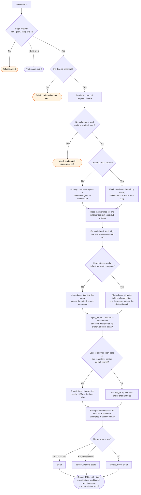

# intersect flow

`node scripts/workstreams.ts intersect` reports each open pull request's head against the
default branch and against each other head. The `/workstreams:start` skill runs it on each tick,
and at the round end.

A pull request from a fork is never a stack layer, and never the layer below one. Its head gets
no worktree, because a local branch of the same name is another branch. A merge against the
default branch has the same three results as a pair: `clean`, `conflict`, or `unread`.
