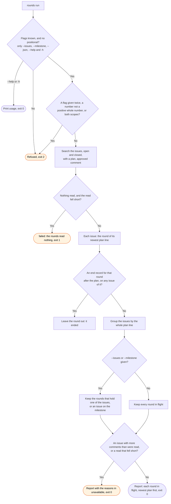

# rounds flow

`node scripts/workstreams.ts rounds` names the rounds in flight, each with its plan line and its
issues. The `/workstreams:start` skill runs it to find the round it continues.

An issue is in one round only: the round of its newest plan comment. So a lookup by the issues of
one round never reaches another round. The search can take a minute to see a new comment.
