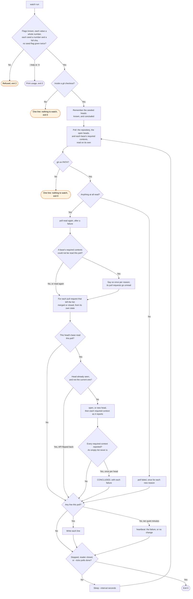

# watch flow

`node scripts/workstreams.ts watch` polls each open pull request, and writes one line for each
event. The plugin monitor runs it when `/workstreams:start` first runs in a session. The skill
runs it under the Monitor tool when the plugin monitor does not run.

The required contexts come from the rules of the base branch. When no ruleset covers the base,
they come from the rules of the default branch. Each stack layer above the first is such a case.

Each base reads its required contexts on its own. A base whose read fails leaves unread only the
pull requests that need its list. The other pull requests still read, and can still conclude. A
failed default branch leaves unread every pull request that falls back to it.

A short list still gives the rows that arrived, and `poll incomplete` names the reason once. A
pull request absent from a short list is not reported as closed. A seeded head is not reported as
open, and a head seeded as concluded does not conclude again. A head this watch has already seen
is not a new head, even after a later one: the API can answer an old head for a short time after a
push. The watch keeps all of this in memory, and writes no file. One known limit: a force push
back to an earlier head, between two polls, is not reported.
