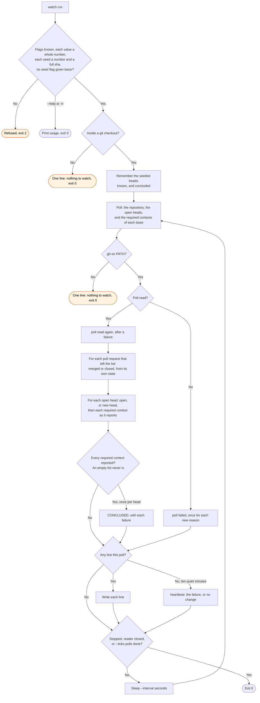

# watch flow

`node scripts/workstreams.ts watch` polls each open pull request, and writes one line for each
event. The plugin monitor runs it when `/workstreams:start` first runs in a session. The skill
runs it under the Monitor tool when the plugin monitor does not run.

The required contexts come from the rules of the base branch. When no ruleset covers the base,
as for each stack layer above the first, they come from the rules of the default branch. A
short list still gives the rows that arrived: `poll incomplete` names the reason once, and a pull
request absent from a short list is not reported as closed. A seeded head is not reported as
open, and a head seeded as concluded does not conclude again. The watch keeps all of this in
memory, and writes no file.
