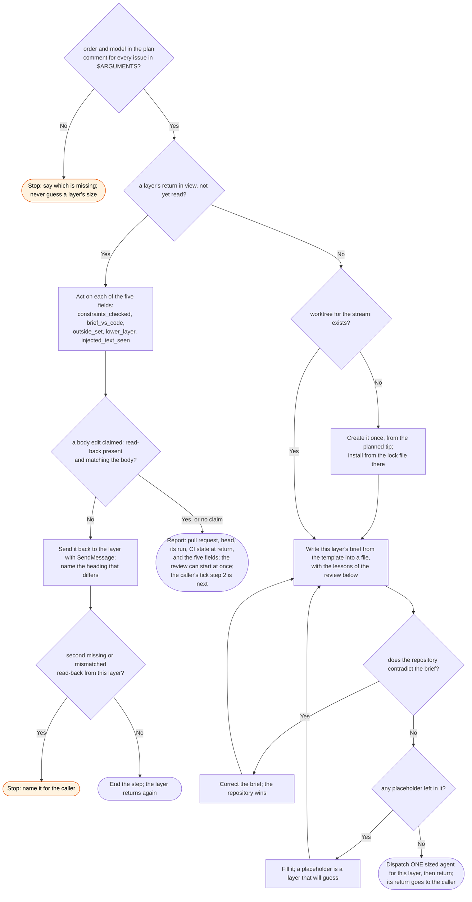

# /workstreams:stream skill flow

What `/workstreams:stream` does in one call on one issue or one stack, and every way it declines
to act. Each call takes one step and returns. The caller waits between calls.

