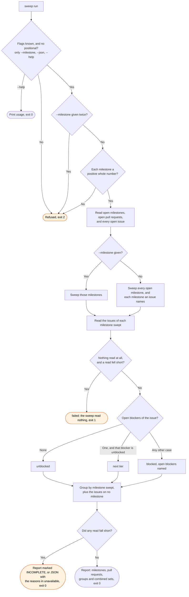

# sweep flow

`node scripts/workstreams.ts sweep` reports what a round could start on, read from the issue
tracker. The `/workstreams:sweep` skill runs it.

A read that partly failed is still an answer, with exit 0. The caller reads the reasons first. An
issue on a milestone outside the sweep gets a tier but appears in no group. An open blocker that
the sweep did not read cannot make an issue `next tier`. `--json` prints the same report as one
JSON object.
