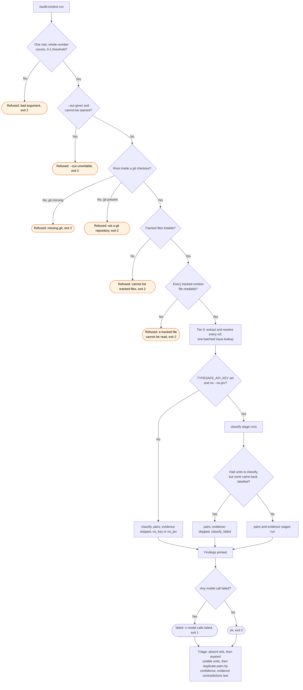

# context: flow

What `/audit:context` does, and every way it can decline to act or come back incomplete.

A stage marked skipped is never read as "nothing found": the report says which reason applied,
and a reviewer acts on tier 0's findings the same way whether or not the model stages ran.
