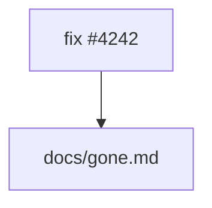

# Opaque

Run this:

```bash
pnpm test
node scripts/build.ts --watch
```

And the shape of it:



And an example from elsewhere:

```bash
# see scripts/build.ts:1 for the entry point
node ../other/tool.ts
```
