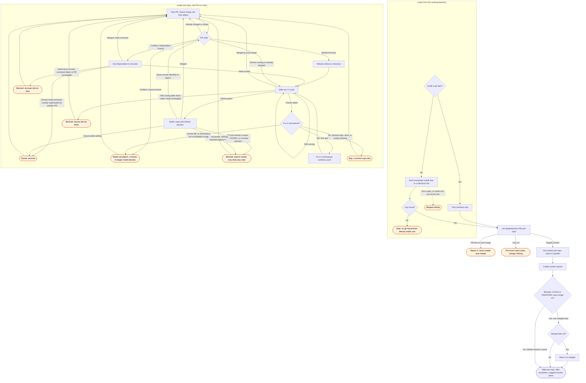

# /gh:shepherd flow

The `discover` subgraph is shared with `/gh:sync`, byte for byte: both skills resolve their
scope by the same rule, `scripts/lib/discover.py`, so the two diagrams must describe it
identically.
