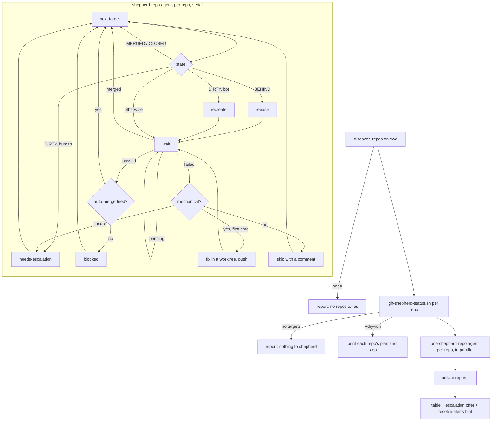

Shepherd the `dependencies` pull requests of the current checkout, or of every checkout one
level down, to merge. Serial within a repo, parallel across repos.



## Step 1 — Discover

```bash
S="${CLAUDE_PLUGIN_ROOT}/scripts"
. "$S/lib/discover.sh" && discover_repos "$PWD"
```

One path per line. If there are none, say "No git repositories directly inside <cwd>" and
stop. Do not classify the directory yourself; the library already did.

## Step 2 — Status

For each path:

```bash
"$S/gh-shepherd-status.sh" <path>
```

Read `targets` and `skipped_no_automerge`. A repo with no targets gets no agent; report it in
one line, including any `skipped_no_automerge` entries so the user can enable auto-merge and
rerun. If the user passed `--dry-run`, print each repo's target list in order (number, title,
author, `mergeStateStatus`, `checks.state`) and stop here.

## Step 3 — Shepherd

Launch one `shepherd-repo` agent per repo that has targets, all in a single message so they
run in parallel. Each agent gets exactly one argument, the repo path, and returns a JSON
report. Do not start a second agent for the same repo, and do not shepherd a repo yourself:
the serial-within-a-repo guarantee lives in the agent.

If the user named a single repo with `--repo <path>`, shepherd only that one.

## Step 4 — Report

Collate the agents' JSON into one table per repo:

| PR | Outcome | Detail |
| --- | --- | --- |
| #n | merged `sha` | rebases: 1 |
| #n | skipped | reason, comment URL |
| #n | blocked | `mergeStateStatus`, reason |
| #n | needs escalation | reason |

Then list `skipped_no_automerge` per repo, and the `ci_seconds` each agent measured.

If any pull request needs escalation, offer to rerun just those with a larger model
(`shepherd-repo` with `model: opus`), and wait for the user's answer; do not rerun on your own.

If the `gh-security` plugin is installed, mention that `/gh-security:resolve-alerts` is the
natural next step: merging `dependencies` pull requests first usually shrinks the alert set
considerably.

## What this skill never does

Enable or disable auto-merge, merge a pull request by hand, bypass or re-run a required check,
resolve conflicts on a branch a human authored, or change a repository's merge method. Those
are the human's decisions; the report tells them where each one is needed.
