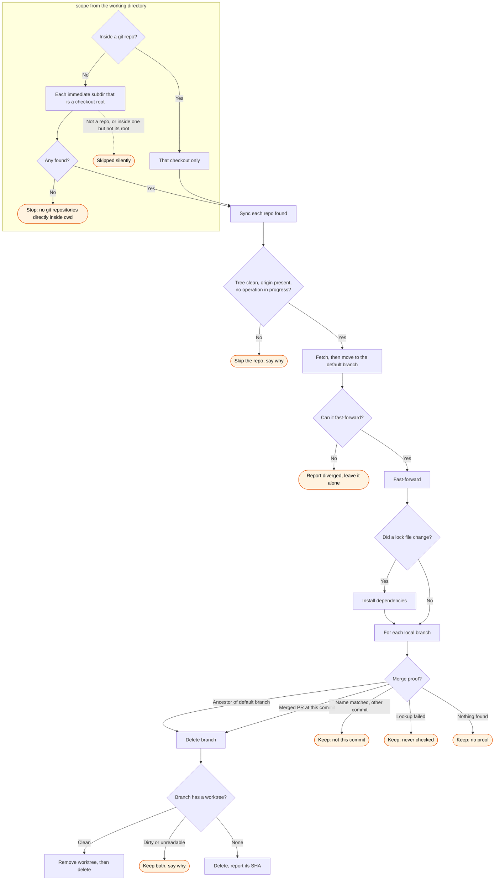

# sync — flow

What `/gh:sync` does, and every way it can decline to act.

Every path that keeps a branch says which of the four reasons applied. The distinction matters:
"never checked" is not "no proof", and reporting one as the other asserts something the command
did not establish.

The `discover` subgraph is shared with `/gh:shepherd`, byte for byte: both skills resolve their
scope by the same rule, `scripts/lib/discover.py`, so the two diagrams must describe it
identically.
