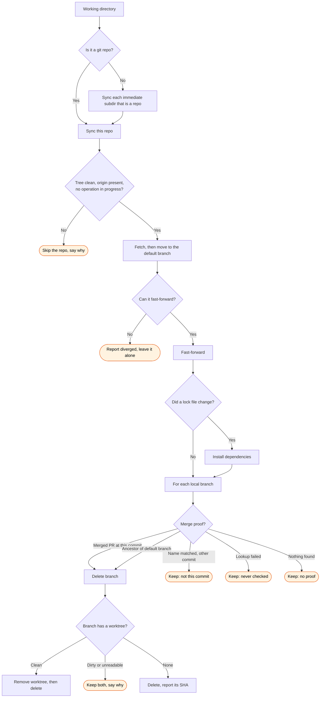

Sync the current checkout, or every checkout one level down.

## Flow



Every path that keeps a branch says which of the four reasons applied. The distinction matters:
"never checked" is not "no proof", and reporting one as the other asserts something the command
did not establish.

## Step 1 — Run

```bash
bash ${CLAUDE_PLUGIN_ROOT}/scripts/gh-sync.sh $ARGUMENTS
```

The script detects its own scope, so do not inspect the directory or classify it first.
Pass the user's arguments straight through. Supported flags: `--dry-run`, `--no-install`,
`-j N`.

If the user asked to preview rather than apply, add `--dry-run`.

## Step 2 — Report

Print the script output verbatim. Then, and only if there were any, list the repositories
that were skipped along with the reason given for each. Do not re-run git commands to
verify or expand on the report.

Deleted branches are printed with their SHA. If the user thinks one was removed in error,
it is restored with `git branch <name> <sha>`; if it also had a worktree, that needs
`git worktree add` and a fresh dependency install.
