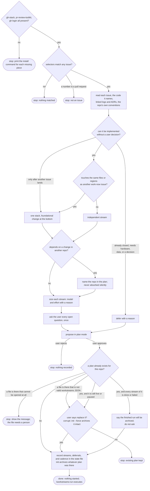

# /workstreams:plan flow

A finished plan is not a question. Every stream of it reached `done` or `failed`, so there is
nothing for the user to decide about replacing it; `init` moves it to the state dir's `archive/`
and the new plan takes its place. Only a run still live, or one holding a `paused` stream whose
question nobody answered, is worth stopping to ask about.
