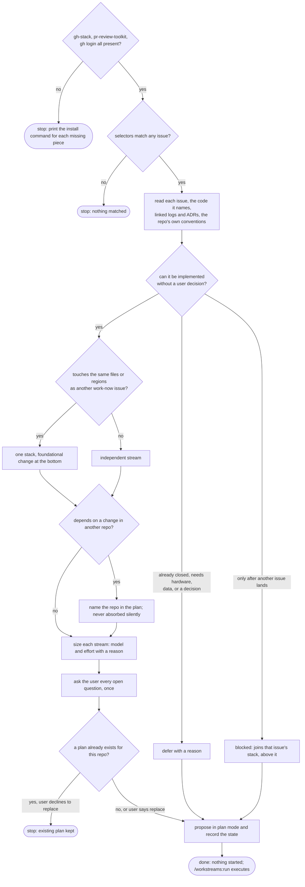

Plan workstreams for the issues in `$ARGUMENTS`. Everything below is procedure; the only
judgment calls are the classification, the collision map, and the sizing, and those are
recorded so `/workstreams:run` never has to re-derive them.

## Flow



## Step 1 — Preflight

```bash
bash ${CLAUDE_PLUGIN_ROOT}/scripts/ws-preflight.sh
```

If it exits non-zero, print each `hint` from the JSON verbatim as a command the user can run,
then stop. Do not work around a missing dependency.

## Step 2 — Resolve the issues

```bash
bash ${CLAUDE_PLUGIN_ROOT}/scripts/ws-issues.sh $ARGUMENTS
```

Pass the arguments straight through. Exit 3 means nothing matched: say so and stop. The output
is a JSON array; `refs` on each issue lists the other issues its body mentions, which seeds the
blocked-on analysis but does not decide it.

## Step 3 — Evaluate

For each issue, read the body, every file or symbol it names, any linked logs or ADRs, and the
target repository's `CLAUDE.md` and `.claude/rules/`. Classify it as one of:

- **work now**: the change is specified well enough to implement without a decision from the user.
- **defer**: needs hardware, needs data that does not exist yet, or needs a decision the user has
  not made. Record the one-line reason.
- **blocked on #N**: cannot start until another issue in the set lands. It joins that issue's
  stream, above it.

A closed issue in the set is deferred with the reason `already closed`.

## Step 4 — Collision map

For every work-now issue, list the files and, where a file is large, the functions or regions
the change will touch. Then:

- Issues whose regions overlap, or where one is blocked on the other, form one **stack**. Order
  it bottom-up: the more foundational or higher-value change goes at the bottom, closest to the
  default branch. Each layer is its own draft PR based on the layer below.
- Issues whose regions are disjoint become **independent streams**.
- A dependency on another repository (a rename here that a hook there relies on) is written into
  the plan explicitly, with the other repo named. It is never silently absorbed into a stream.

## Step 5 — Size each stream

Use `sizing.md` in this directory. Record model, effort, and a one-line reason per stream. The
model is passed per call; the effort selects which `stream-<effort>` agent runs the stream.

## Step 6 — Ask, then propose

Before entering plan mode, ask the user every question the plan depends on with
`AskUserQuestion`: an ambiguous classification, a stack order that could go either way, a
cross-repo dependency they may want handled elsewhere. Ask them together, once.

Then `EnterPlanMode`, write the plan using `plan-template.md` in this directory, and persist the
same content to the state file:

```bash
S="bash ${CLAUDE_PLUGIN_ROOT}/scripts/ws-state.sh"
$S init                      # add --force only if the user said to replace an existing plan
$S add-stream <id> --issues <n,n> --kind independent|stack --model <alias> --effort <level> \
   --reason "<why this size>" [--order <n>] [--base <branch-of-layer-below>]
$S defer <issue> "<reason>"
$S meta loop_delay <seconds>   # the cadence from the plan's Loop section
$S meta plan_path <path to the plan file>
```

Stream ids are short and stable, `s1`, `s2`, and so on; stacked layers share a prefix such as
`s1a`, `s1b`, with `--order` giving the position from the bottom starting at 1 and `--base` naming
the branch of the layer below (the default branch for the bottom layer, which may be omitted).

If `init` exits 3 a plan already exists for this repo. Show the user `ws-state.sh show` and ask
whether to replace it before proceeding with `--force`.

Finish with `ExitPlanMode`. Do not start any stream: that is `/workstreams:run`.
