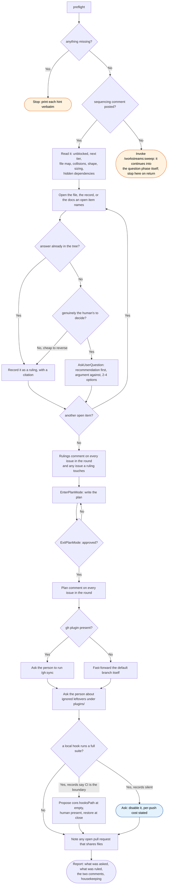

# question, flow

What `/workstreams:question` does to one sweep report, and every way it declines to act.

The hook question, when the records are silent, is the one case in the whole skill where a
cheap ruling is not taken: disabling a push-time suite changes what protects the round, so
it is asked rather than ruled even though it is, in every other sense, reversible.
