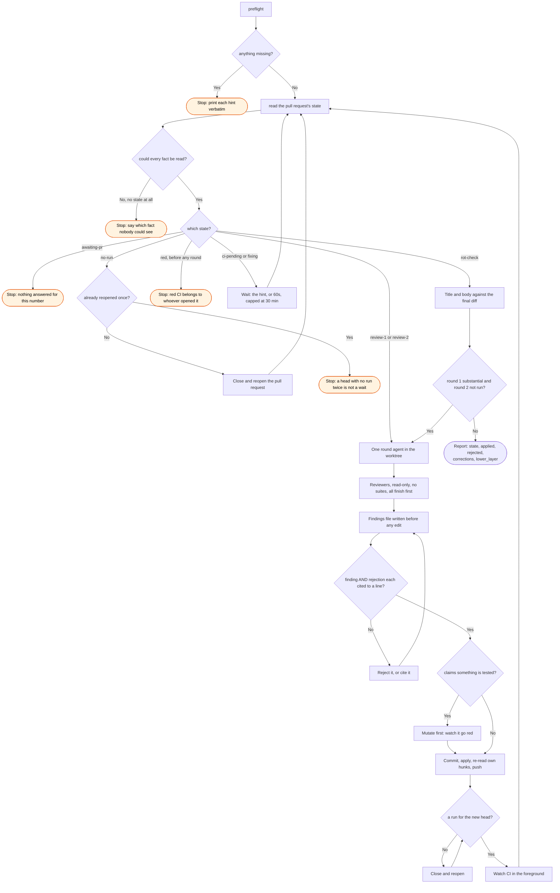

# review, flow

What `/workstreams:review` does to one pull request, and every way it declines to act.

The stops are different facts and are reported as different facts. A preflight failure
is a machine that cannot run the round. No state at all is a fact nobody could read, and
acting on it would send a round to review checks it has not seen. Red CI before any
round has run is someone else's problem, because nothing this skill did caused it.

Every loop back goes through the state read, never through a memory of it: there is no
state file, and the only things carried between ticks are how many rounds have completed,
whether round 1 was substantial, and whether the rot check is done.
