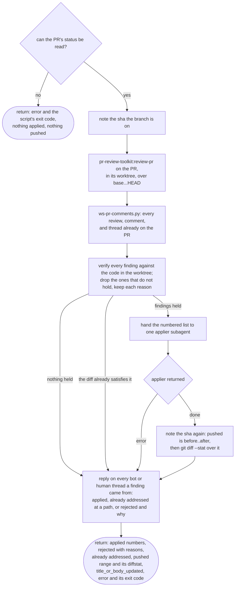

# /workstreams:review flow

The round runs in the session that invoked it, never in a subagent, because
`/pr-review-toolkit:review-pr` dispatches analyzer agents whose completion wakes whoever
dispatched them. A subagent has no such wake to receive and would fall back to a timed wait,
idling for the rest of the interval after the analyzers had already finished (issue #62). The
applier is a subagent because it takes a finished list and returns once, which is a bounded job.

A thread is never resolved here, on any path, including the one where the finding was applied.
Resolving is the reviewer's judgement that the matter is closed; the round says what it did and
leaves the decision with them.

Substantial or cosmetic is defined in this skill's Return section, next to the `diffstat` the
definition is read off; both callers cite it from there rather than restating it.

Nothing on any path writes a state file, counts a round, or schedules a wake. What is due after
this round is the caller's decision, and the caller is the only thing that survives between ticks:
`/workstreams:run` Step 4 and `/field-test:harden`'s review phase.
