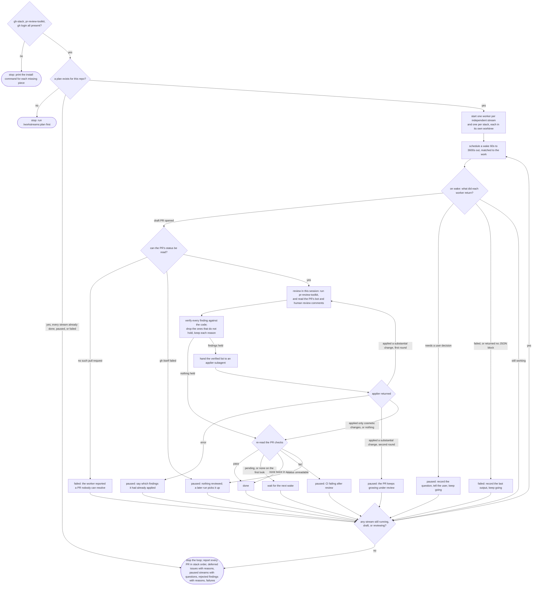

# /workstreams:run flow

Layers of a stack are reviewed bottom-up: a layer's review does not start until the layer below
it is `done`, because a change applied below changes what the layer above rebases onto.

The review runs in the main session rather than inside a subagent because
`/pr-review-toolkit:review-pr` dispatches analyzer agents whose completion wakes the session that
invoked it. A subagent has no such wake to receive, so it would fall back to a timed wait and
hang for the rest of the interval after the analyzers had already finished (issue #62). The
applier subagent takes a finished list and returns once, which is a bounded job.
