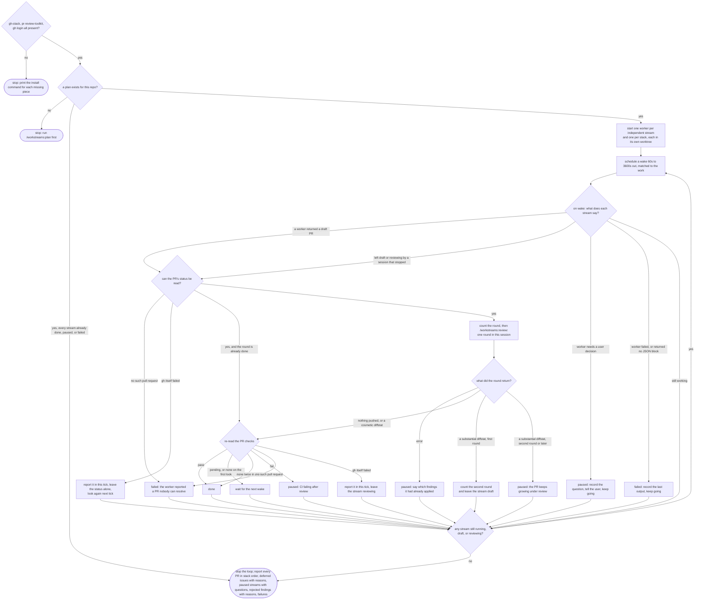

# /workstreams:run flow

Layers of a stack are reviewed bottom-up: a layer's round does not start until the layer below it
is `done`, because a change applied below changes what the layer above rebases onto.

The substantial-first-round edge goes back through the tick boundary rather than straight into
another round. The stream is left `draft` with its second round already counted, so the next wake
brings it round to the same status check, and a session that stops in between picks it up from
disk instead of from a decision only the running loop remembered.

Neither way of failing to read the PR's status pauses a stream any more. `paused` is a question
for a person, and Step 1 does not resume a paused stream, so pausing over a rate limit or a
network blip would strand work the next tick could have finished. The message goes in the tick's
report and the status is left where it was.

The review runs in the main session rather than inside a subagent because
`/pr-review-toolkit:review-pr` dispatches analyzer agents whose completion wakes the session that
invoked it. A subagent has no such wake to receive, so it would fall back to a timed wait and
hang for the rest of the interval after the analyzers had already finished (issue #62). The
applier subagent takes a finished list and returns once, which is a bounded job.
