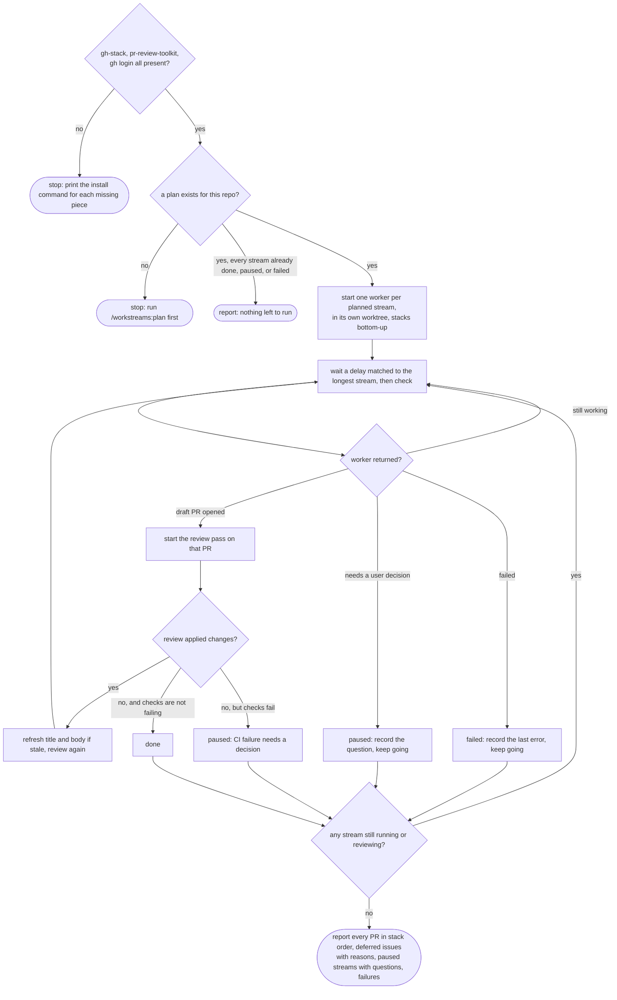

Run the workstreams recorded for this repository. The state file is the source of truth; every
transition below is written to it before the next action, so a stopped session can re-run this
skill and continue.

## Flow



## Step 1 — Preflight and load

```bash
bash ${CLAUDE_PLUGIN_ROOT}/scripts/ws-preflight.sh
S="bash ${CLAUDE_PLUGIN_ROOT}/scripts/ws-state.sh"
$S show
```

Stop with the install hints if preflight fails. Stop and say to run `/workstreams:plan` if there
is no state file. If no stream is `planned`, `running`, `draft`, or `reviewing`, skip to Step 5.

Read the target repository's `CLAUDE.md` and `.claude/rules/` once now; the briefs below quote
its conventions rather than inventing any.

## Step 2 — Start the streams

For each stream with status `planned`, fill in `stream-prompt.md` from this directory and start
one worker with the `Agent` tool:

- `subagent_type`: `workstreams:stream-<effort>` where effort is the stream's recorded effort.
- `model`: the stream's recorded model.
- The prompt is the filled brief. Independent streams start together in one message. A stack is
  one worker that works its layers bottom-up, using `gh stack` for the branches and PRs, so the
  layers share one brief listing every layer in order.

Then record it:

```bash
$S set <id> status running
$S set <id> agent "<agent name or id>"
```

Do not create worktrees or branches yourself. The worker does that, following the target repo's
conventions, and reports the branch and worktree back.

## Step 3 — Wait, then check

Schedule the next check with `ScheduleWakeup`, passing this skill's invocation as the prompt so
the loop re-enters here. Choose the delay from `meta.loop_delay` in the state file; if it is
missing, use the plan's estimate of the longest stream, and never poll faster than the tool's
idle default. A `noop` tick is one where no stream changed state.

On each wake:

1. **Workers that returned.** Parse the JSON block at the end of each result.
   - `status: draft`: record `branch`, `worktree`, `pr`, set status `draft`, and go to Step 4.
   - `status: paused`: record `question`, set status `paused`. Tell the user the question in the
     tick's message. Never block on it; the other streams continue.
   - `status: failed`: record the error in `question`, increment `attempts`, set status `failed`.
     No automatic retry: the failure policy is deliberately out of scope for now.
2. **Streams still `running`** stay running. Do not message the worker to ask for progress.
3. If every stream is `done`, `paused`, or `failed`, go to Step 5. Otherwise schedule the next
   wake and end the turn.

## Step 4 — Review pass

For a stream that just reached `draft`, or whose review applied changes last time:

```bash
bash ${CLAUDE_PLUGIN_ROOT}/scripts/ws-pr-status.sh <pr>
$S set <id> status reviewing
```

Fill in `review-prompt.md` from this directory and start `workstreams:reviewer` with `model` set
to the stream's model. When it returns:

- `applied > 0`: the diff changed, so the PR needs one more pass. Set status `draft` and it will
  be reviewed again on the next tick.
- `applied == 0` and `checks` is `pass`, `pending`, or `none`: set status `done`.
- `applied == 0` and `checks` is `fail`: set status `paused` with the question
  `CI is failing on PR #N after review; decide whether to fix, retry, or drop the stream`.

For a stack, review the layers bottom-up and do not start the review of a layer until the layer
below it is `done`; a change applied below changes what the layer above rebases onto.

## Step 5 — Report

Print one report and stop the loop (`ScheduleWakeup` with `stop: true`):

- **Pull requests**, one line per stream, stacks grouped and listed bottom-up: PR number, title,
  checks, review decision.
- **Deferred issues** with their reasons, from `.deferred`.
- **Paused streams** with the exact question each is waiting on.
- **Failed streams** with the last error.

The PRs are drafts. Marking them ready and merging is the user's decision.
