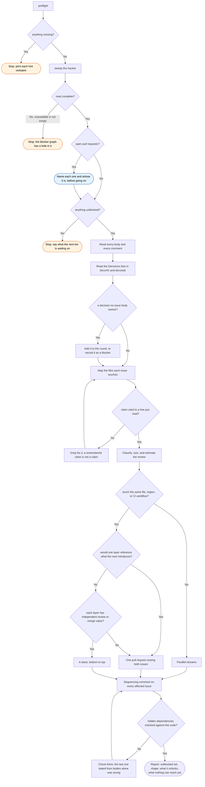

# sweep, flow

What `/workstreams:sweep` does, and every way it declines to act.

The three stops are different facts and are reported as different facts. A preflight
failure is a machine that cannot run the round; an incomplete read is a question that
could not be answered; an empty unblocked set is an answer, and the useful half of it is
what the next tier is waiting on.
